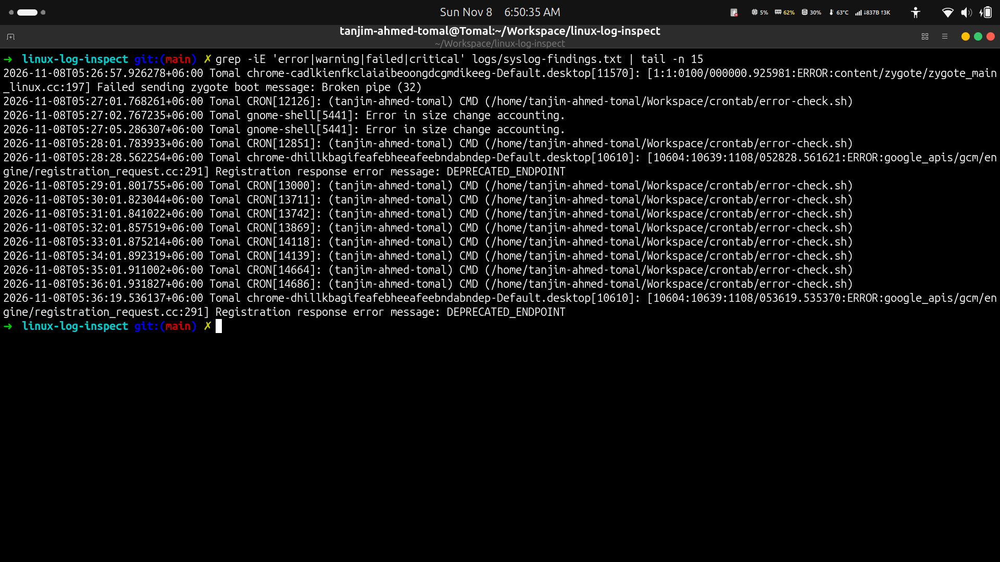
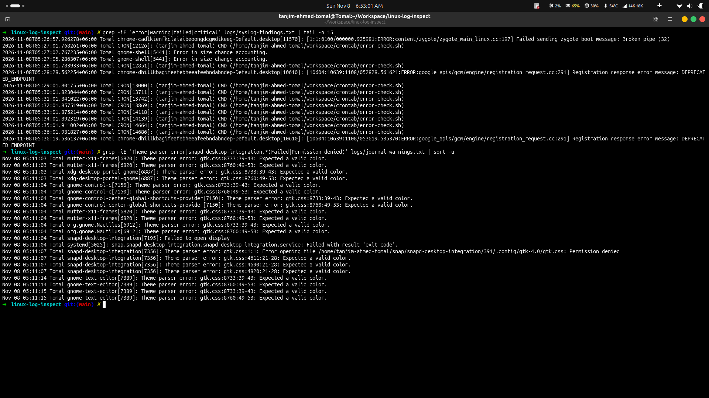
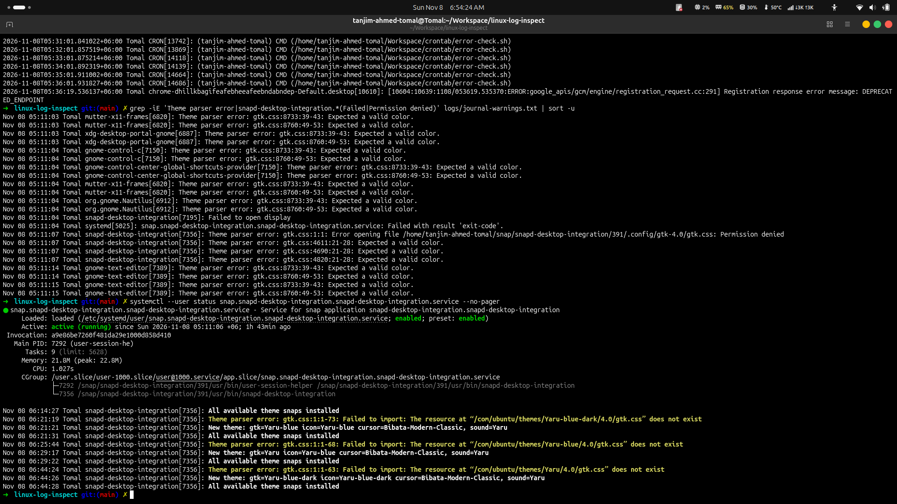
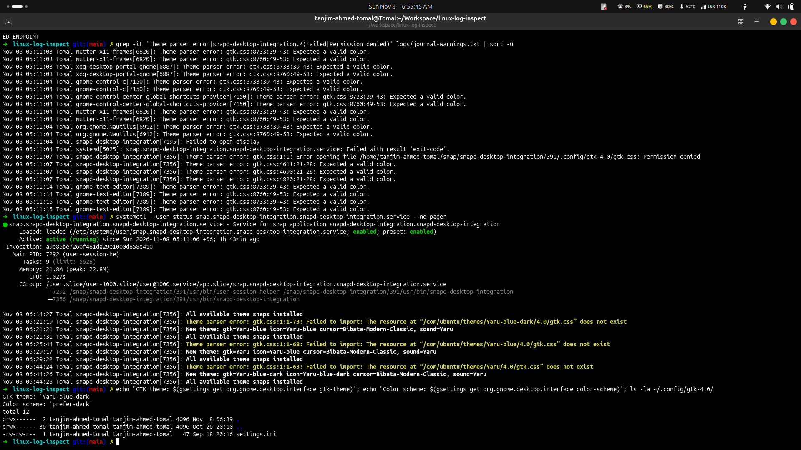
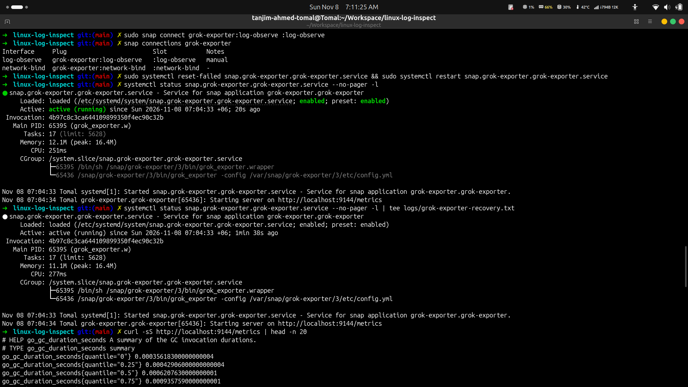
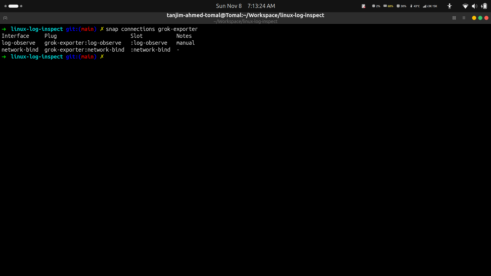
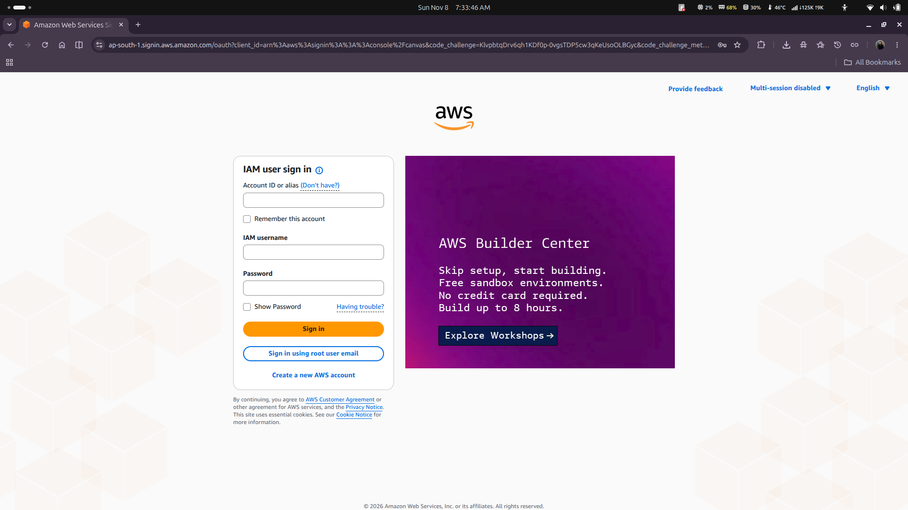
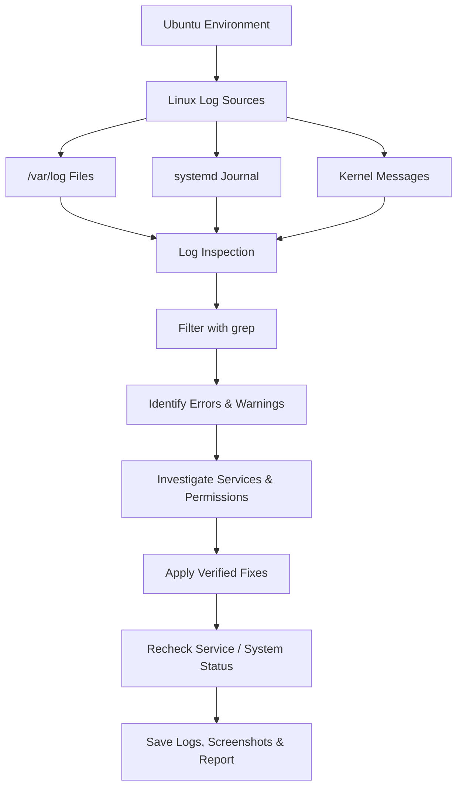

 <p align="center">
  
</p>

<h1 align="center">Linux Log Inspection & Basic Troubleshooting</h1>

<p align="center">
  <strong>Hands-on Linux system log analysis and practical troubleshooting on Ubuntu</strong>
</p>

<p align="center">
  
  
  
  
  
</p>

---

## Overview

A beginner-level Linux troubleshooting project focused on inspecting system logs, identifying warnings and errors, understanding service failures, and documenting practical fixes.

The work was performed in an Ubuntu environment using standard Linux diagnostic utilities. Findings were collected from system logs, the systemd journal, kernel messages, and service status output.

**Objectives**
- Navigate the Linux filesystem and explore `/var/log`.
- Inspect system and kernel logs.
- Filter relevant messages using command-line tools.
- Identify and interpret errors and warnings.
- Troubleshoot selected service and desktop issues.
- Preserve evidence and document the investigation.

## Technology Stack

<p>
  
  
  
  
  
</p>

| Tool | Purpose |
|---|---|
| `journalctl` | Inspect systemd journal entries |
| `grep` | Filter errors, warnings, and relevant messages |
| `less`, `tail`, `cat` | Read and inspect log files |
| `dmesg` | Inspect kernel messages |
| `systemctl` | Check and troubleshoot services |
| `snap` | Inspect Snap interfaces and permissions |
| `curl` | Verify local service endpoints and HTTP responses |
| Git & GitHub | Version control and project documentation |

## Screenshots & Evidence

### 01 — Syslog Investigation


*Filtered system log entries to identify relevant errors, warnings, and application messages.*

### 02 — Journal Warnings


*Inspected warning-level systemd journal entries to investigate system and service behaviour.*

### 03 — Snap Service Recovery


*Checked the Snap desktop integration service and verified its recovered running state.*

### 04 — Ubuntu Theme Troubleshooting


*Restored the Ubuntu Yaru appearance after investigating outdated GTK theme configuration links.*

### 05 — Grok Exporter Service Recovery


*Verified the Grok Exporter service after resolving its log-access permission issue.*

### 06 — Snap Permission Investigation


*Inspected Snap interface connections and verified the required `log-observe` permission.*

### 07 — AWS Endpoint Network Test


*Additional network troubleshooting evidence: checked AWS sign-in endpoint response and browser loading behaviour.*

## Architecture & Investigation Workflow



## Log Findings

| Finding | Interpretation | Investigation |
|---|---|---|
| Grok Exporter: `permission denied` while accessing `/var/log/syslog` | The Snap application lacked the required log-observation access. | Checked Snap connections and identified the disconnected `log-observe` interface. |
| GTK theme parsing issues | Outdated GTK theme configuration links were pointing to an old theme setup. | Inspected GTK configuration and identified obsolete theme symlinks. |
| Kernel and hardware-related warnings | Several warnings were reported by kernel components and drivers. | Reviewed warning-level journal entries and recent `dmesg` output; did not assume every warning represented a failure. |
| Snap desktop integration display error | A service had reported a display-related error before recovering. | Checked the user service status and confirmed it was active afterward. |

## Troubleshooting & Resolutions

| Issue | Action taken | Verification |
|---|---|---|
| Grok Exporter could not read `/var/log/syslog` | Connected the Snap `log-observe` interface and restarted the service. | Service became active and the local metrics endpoint responded. |
| Outdated GTK theme configuration | Backed up GTK configuration and removed obsolete theme symlinks. | Ubuntu Yaru appearance was restored. |
| Snap desktop integration service error | Inspected service status and journal output. | Service was observed running afterward; the original cause was not conclusively established. |
| System warning investigation | Reviewed kernel and journal messages without applying unverified fixes. | Saved diagnostic output for further reference. |
| AWS Console loading delay (additional investigation) | Cleared Chrome's host resolver cache and tested the AWS sign-in endpoint over IPv4. | Endpoint returned HTTP 200; browser loading improved slightly. |

**Service verification:** After the service troubleshooting work, `systemctl --failed` showed no failed loaded units in the captured output.

## Useful Linux Log Inspection Commands

**1. Explore system log files**
```bash
ls -lah /var/log/
```

**2. Read a log file**
```bash
sudo less /var/log/syslog
```

**3. Display recent log entries**
```bash
sudo tail -n 50 /var/log/syslog
```

**4. Search for errors and warnings**
```bash
sudo grep -iE 'error|warning|failed|critical' /var/log/syslog
```

**5. Inspect warning-level journal entries**
```bash
sudo journalctl -p warning..alert --no-pager
```

**6. Inspect kernel messages**
```bash
sudo dmesg --level=err,warn --ctime
```

**7. Check failed system services**
```bash
systemctl --failed --no-pager
```

**8. Inspect a specific service**
```bash
systemctl status snap.grok-exporter.grok-exporter.service --no-pager
```

**9. Inspect Snap interface connections**
```bash
snap connections grok-exporter
```

**10. Verify the local metrics endpoint**
```bash
curl -s http://127.0.0.1:9144/metrics
```

## Project Structure

```text
linux-log-inspect/
├── logs/
│   ├── auth-findings.txt
│   ├── aws-console-network-test.txt
│   ├── disk-usage.txt
│   ├── dmesg-recent.txt
│   ├── failed-services-after-fix.txt
│   ├── grok-exporter-metrics.txt
│   ├── grok-exporter-recovery.txt
│   ├── grok-exporter-service.log
│   ├── grok-exporter-snap-connections.txt
│   ├── journal-warnings.txt
│   ├── kernel-warnings.txt
│   └── syslog-findings.txt
├── reports/
│   └── troubleshooting-report.md
├── screenshots/
│   ├── 01-syslog-findings.png
│   ├── 02-journal-warnings.png
│   ├── 03-snap-service-recovery.png
│   ├── 04-yaru-theme-fix.png
│   ├── 05-grok-exporter-fix.png
│   ├── 06-grok-exporter-permission.png
│   └── 07-aws-console-network-test.png
└── README.md
```

## Deliverables

- [x] Ubuntu environment setup and filesystem navigation
- [x] Inspection of files under `/var/log`
- [x] System journal inspection using `journalctl`
- [x] Log filtering using `grep`
- [x] Identification and interpretation of log findings
- [x] Troubleshooting report
- [x] Diagnostic logs and screenshots
- [x] Practical service troubleshooting and verification

## Learning Outcome

This project strengthened practical Linux administration skills, including log analysis, service inspection, permission troubleshooting, kernel warning investigation, and evidence-based documentation.

**Key takeaway:** A warning or error message should be investigated and verified before deciding whether it requires a fix.

---

<p align="center">
  <strong>Linux • Log Analysis • System Troubleshooting</strong>
</p>
